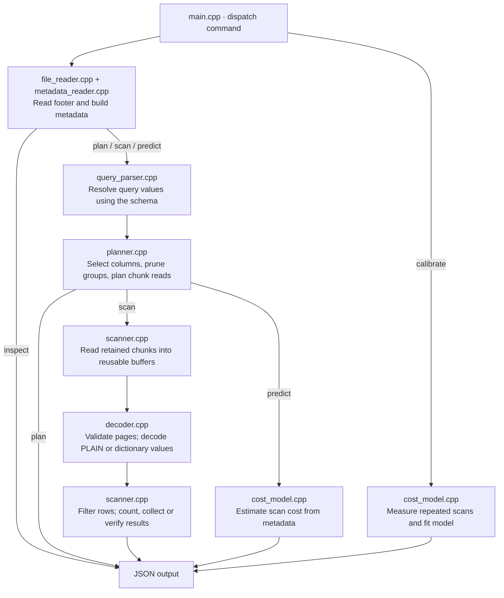

# COL868 · Parquet Performance Engine

A C++20 Parquet scanner for studying **column projection, physical ordering, encoding, and query cost**. It reads metadata, prunes row groups, decodes selected columns, applies equality/range predicates, and predicts scan time from metadata.

**Supported scans:** flat, required `INT32`, `INT64`, and `DATE` columns; uncompressed V1 pages; PLAIN and dictionary encoding with RLE/bit-packed IDs. Results are JSON. This is a focused scan engine, not a SQL database.

## Clone and build

Requires Git, a C++20 compiler, and CMake ≥3.20. Use Linux/WSL2 and keep benchmark data on its Linux filesystem.

```bash
git clone https://github.com/Suhani-IITD/COL868-Parquet-Performance-Engine.git
cd COL868-Parquet-Performance-Engine

# Check existing tools first.
c++ --version
cmake --version
thrift --version
pkg-config --modversion thrift

# Ubuntu: install missing dependencies; Python venv is for experiments.
sudo apt-get update
sudo apt-get install -y build-essential cmake pkg-config libboost-dev \
  thrift-compiler libthrift-dev nlohmann-json3-dev python3-venv

cmake -S . -B build -DCMAKE_BUILD_TYPE=Release
cmake --build build -j 2
./build/parquet_metadata --help
```

CMake generates private Thrift bindings from the bundled Parquet schema. Arrow/DuckDB are used by the Python experiments, not by the C++ scanner; OpenSSL is not an explicit build dependency.

## Run

Set up the experiments and generate a small dataset, or use an existing supported file:

```bash
python3 -m venv experiments/.venv
experiments/.venv/bin/python -m pip install -r experiments/requirements.txt

# Initial generation downloads DuckDB's TPC-H extension.
experiments/.venv/bin/python experiments/generate.py --sf 0.01 --out experiments/data
FILE=experiments/data/sf0.01/lineitem_shipdate_dict_rg4096.parquet

./build/parquet_metadata inspect "$FILE"
./build/parquet_metadata plan "$FILE" --select l_extendedprice_cents \
  --where l_shipdate --ge 1994-01-01 --lt 1995-01-01
./build/parquet_metadata scan "$FILE" --select l_extendedprice_cents \
  --where l_discount_pct --eq 5 --timing

# Performance pipeline: generate → calibrate → benchmark → report.
BIN="$PWD/build/parquet_metadata" PYTHON="$PWD/experiments/.venv/bin/python" \
  SCALES="0.01" REPEATS=3 bash experiments/run_all.sh
```

The quick run writes `experiments/results/model.json`, `sf0.01.csv`, and `sf0.01.md`. For the default SF **0.1 and 1** study, omit `SCALES` and `REPEATS` from the last command. Larger scales generate many full copies of the dataset.

| Command / option | Purpose |
|---|---|
| `inspect FILE` | File/schema summary; reads metadata only |
| `plan FILE --select A,B` | Required columns, retained groups, and planned chunk bytes |
| `scan FILE --select A,B` | Decode requested columns and return matching count/counters |
| `calibrate FILE [FILE ...] > model.json` | Fit stage costs using repeated measured scans |
| `predict FILE --select A,B --model model.json` | Predict costs without reading data pages |
| `--where COL --eq VALUE` | Equality on one predicate column |
| `--ge` / `--gt`, `--le` / `--lt` | Inclusive/exclusive endpoints; combine for a range |
| `--no-prune` | Disable statistics pruning |
| `--rows` | Include projected rows; bounded to 100,000 rows / 1,000,000 cells |
| `--verify` | Compute value fingerprint and column summaries outside timing |
| `--timing` | Planning, read, allocation, decode, filter, and execution times |
| `--diagnostics` | Per-chunk counters; with timing, nested decoder-stage times |
| `--naive-decoder` | Use bit-at-a-time ID unpacking instead of word loads |
| `--separate-ids` | Decode IDs into a buffer, then gather dictionary values; default is fused |
| `--json`, `--help` | JSON is already the default; show command usage |

Query commands require `--select`. Dates accept `YYYY-MM-DD` or epoch days. `--eq` cannot be mixed with range endpoints; `--verify` and `--timing` run separately. A count-only scan still decodes selected columns—it is not a metadata-only `COUNT(*)` shortcut.

## Code flow



CLI flags are parsed before opening the file; predicate values are converted after the schema is loaded. For `scan`, planning happens inside the scanner, and the read → decode → filter sequence repeats for each retained group.

| Files / directory | Responsibility |
|---|---|
| [`src/main.cpp`](src/main.cpp), [`src/query_parser.cpp`](src/query_parser.cpp) | Dispatch commands; turn raw flags into typed predicates after schema loading |
| [`src/file_reader.cpp`](src/file_reader.cpp), [`src/metadata_reader.cpp`](src/metadata_reader.cpp) | Exact reads, footer parsing, schema/row-group/chunk conversion |
| [`include/parquetscope/`](include/parquetscope/) | Owned metadata, query/plan/result structs, buffer and timing interfaces |
| [`src/planner.cpp`](src/planner.cpp) | Projection ∪ predicate columns; conservative pruning; whole-chunk ranges |
| [`src/scanner.cpp`](src/scanner.cpp), [`src/decoder.cpp`](src/decoder.cpp) | Reusable storage, validated decoding, filtering, result collection |
| [`src/cost_model.cpp`](src/cost_model.cpp) | Metadata-derived workload estimates, calibration, stage predictions |
| [`src/value_digest.cpp`](src/value_digest.cpp), `src/*_json.cpp` | Optional value verification and JSON formatting |
| [`third_party/parquet_format/`](third_party/parquet_format/) | Pinned schema and attribution; generated bindings live under `build/` |

## Experiment harness

[`experiments/run_all.sh`](experiments/run_all.sh) orchestrates:

1. **`generate.py`** — DuckDB generates TPC-H LINEITEM; PyArrow writes 11 required numeric/date columns. Money/percentages use scaled integers. Each scale has **40 layouts**: 5 orders × 2 encodings × 4 row-group sizes.
2. **Calibration** — random and shipdate-sorted files from the first scale train `model.json`.
3. **`benchmark.py`** — compare matching counts with single-thread DuckDB; run an untimed verification pass, one warm-up, then repeated timed CLI scans. Save median stage times, process wall time, bytes, decode counters, and predictions to CSV.
4. **`report.py`** — produce Markdown tables for pruning, projection, encoding, decoder modes, and prediction error.

| Runner variable | Default / meaning |
|---|---|
| `SCALES` / `REPEATS` | `"0.1 1"` / `5`; repeats control benchmarking, calibration uses 5 |
| `BIN` / `PYTHON` | `../build/parquet_metadata` / `python3`; absolute paths avoid ambiguity |
| `DATA` / `OUT` | `data` / `results`, relative to `experiments/` |

Existing scale directories are reused; use a fresh `DATA` directory after changing generation settings. Warm-up targets a warm OS cache, while every CLI invocation starts a fresh process.

| Experiment | Current sweep / comparison | What it measures |
|---|---|---|
| Physical ordering | Random, orderkey, shipdate, partial clustering ±30/±365 days | Clustering effects on pruning and decoding |
| Row-group size | 4,096; 16,384; 131,072; 1,048,576 rows | Pruning granularity versus metadata/chunk overhead |
| Date ranges | 0.1%, 1%, 5%, 10%, 25%, 50%, 100% of the date domain | Narrow/wide predicates; actual match fraction is recorded |
| Order-key ranges | 0.1%, 1%, 10%, 50% of the key domain | Filtering on another ordering key |
| Equality / full scan | Discount = 5; unfiltered quantity scan | Equality filtering and a decoding-heavy baseline |
| Pruning / projection | Default, no pruning, all 11 columns without pruning | Skipped groups versus avoided columns; all-columns is still Parquet, not a row store |
| Encoding / decoder | PLAIN vs dictionary; default vs naive vs separate IDs | File size and decode cost; decoder variants run on dictionary equality/full-scan cases |
| Cost prediction | Estimated versus measured latency; estimated versus observed run values | Model error and feature-estimation quality |

**Interpretation:** DuckDB validates counts, not projected-value fingerprints; its `COUNT(*)` may read fewer columns than our scan. Calibration files overlap part of the evaluated dataset, so errors are not uniformly held-out accuracy. Bytes are application reads, not physical disk traffic. Use generated reports for measurements; no fixed speedup is promised.
